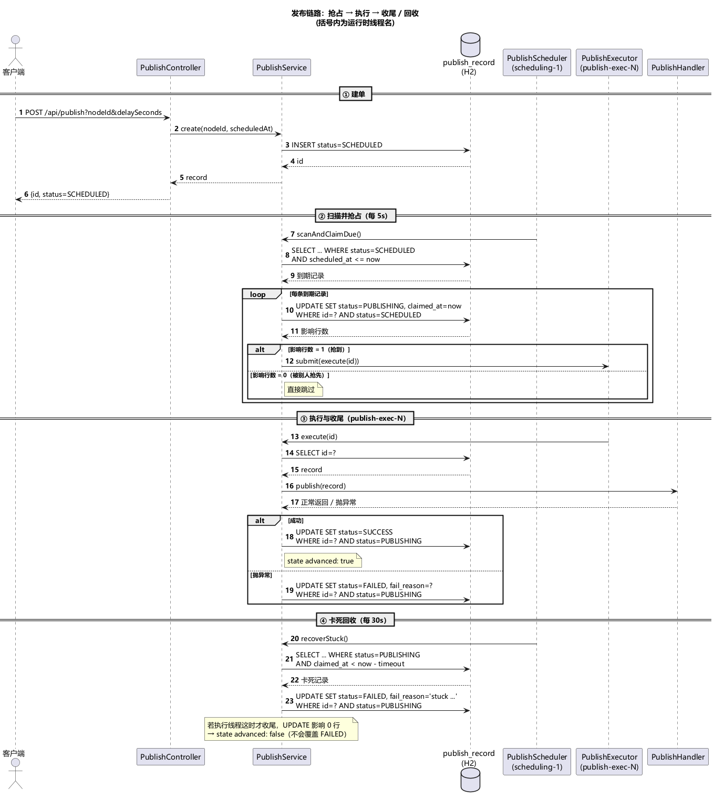
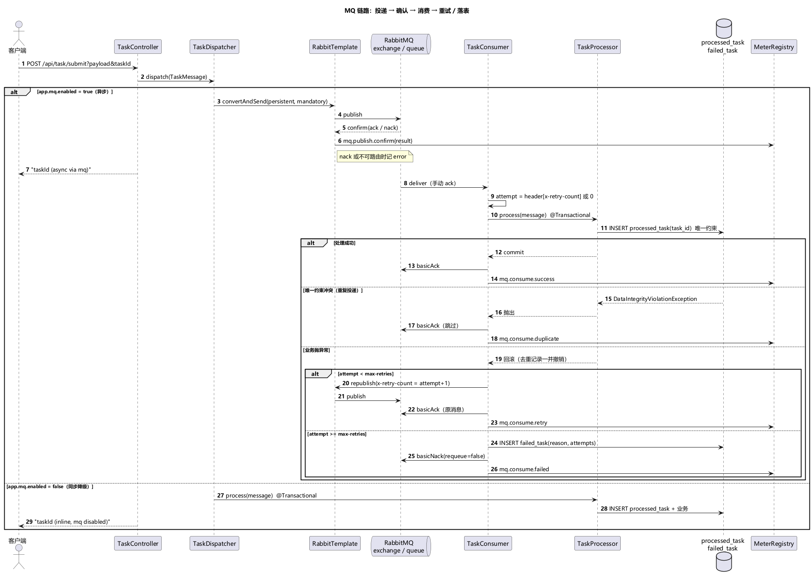

# 时序图：发布链路与 MQ 链路

> 两份图都由 PlantUML 渲染为 PNG，源文件在 `docs/diagrams/*.puml`。
> 括号里是运行时线程名，可在 `logs/app.log` 里对照。

---

## 1. 发布链路：抢占 → 执行 → 收尾 / 回收



涉及线程：`http-nio-*`（请求）、`scheduling-1`（调度）、`publish-exec-N`（执行池）。

### 为什么这么设计

| 决策 | 原因 |
|---|---|
| `claimed_at` 与状态写在同一条 UPDATE | 分两条写会出现「状态已变、时间没写」，回收任务会把正在执行的记录误判成卡死 |
| 执行与回收都用条件更新 | 两个线程可能同时收尾；只有影响行数为 1 的那个算数，另一个自然落空 |
| 执行池用 `CallerRunsPolicy` | 队列满时回退到调度线程执行，形成背压；丢任务会留下永远停在 `PUBLISHING` 的记录 |
| 回收阈值独立于执行超时 | 执行耗时是业务属性，卡死阈值是运维属性，两者不该耦合 |

### 竞态时间线（实测）

```
t=0.0s   claimed（scheduling-1）
t=0.0s   publish 开始（publish-exec-1，耗时 5s）
t=5.0s   recoverStuck → FAILED（scheduling-1）
t=5.01s  execute 收尾 → UPDATE 影响 0 行 → state advanced: false
```

---

## 2. MQ 链路：投递 → 确认 → 消费 → 重试 / 落表



涉及组件：`RabbitTemplate`（生产）、`TaskConsumer`（消费）、`TaskProcessor`（事务内幂等 + 业务）、`failed_task`（兜底）。

### 为什么这么设计

| 决策 | 原因 |
|---|---|
| 去重记录与业务动作同一事务 | 若先提交去重再干活，业务失败后重试会被判成「重复消息」直接跳过，任务就悄悄丢了 |
| 失败用「重新投递 + 计数头」而不是 `nack(requeue=true)` | 立即重回队列会原地打转，把消费者钉死；带计数重投能限制次数，也能被别的实例接手 |
| 重试耗尽写 `failed_task` 再 nack | 毒消息留在队列里会反复投递；落表后既保留了现场，又释放了队列 |
| 生产端开 confirm + returns | confirm 回答「broker 收下没有」，returns 回答「收下但没有队列接收」，两者都缺就完全不知道投递结果 |
| 生产端不开同步降级 | 异步是设计的一部分：投递失败直接抛错，避免"看起来成功、其实同步跑了"的假象 |

### 关键指标

| 指标 | 含义 |
|---|---|
| `mq.publish.confirm{result=ack\|nack}` | 生产端确认结果 |
| `mq.publish.returned` | 消息未路由到任何队列 |
| `mq.consume.success` | 正常消费 |
| `mq.consume.duplicate` | 唯一约束拦下的重复投递 |
| `mq.consume.retry` | 失败后重新投递 |
| `mq.consume.failed` | 重试耗尽，已写 `failed_task` |

查看方式：`GET /actuator/metrics/mq.consume.success`

---

## 3. 两张图的关系

发布链路和 MQ 链路是两条独立的路：发布走「状态机 + 线程池」，任务走「消息队列 + 消费者」。

共同点只有两条，也是这个项目想说明的重点：

1. **中间状态必须可恢复**：发布卡在 `PUBLISHING` 有回收任务，消息消费失败有重试与失败表。
2. **并发正确性靠数据库条件更新与唯一约束**，而不是靠加锁或「先查后写」。

---

## 4. 重新生成 PNG

源文件：`docs/diagrams/publish-sequence.puml`、`docs/diagrams/mq-sequence.puml`。

```bash
# 需要 PlantUML jar（不随仓库提交）
java -Djava.awt.headless=true -jar plantuml.jar -tpng -charset UTF-8 -o .. docs/diagrams/*.puml
```

中文字体由 `skinparam defaultFontName "Microsoft YaHei"` 指定；在 Linux/macOS 上渲染时换成系统里已安装的中文字体即可。
