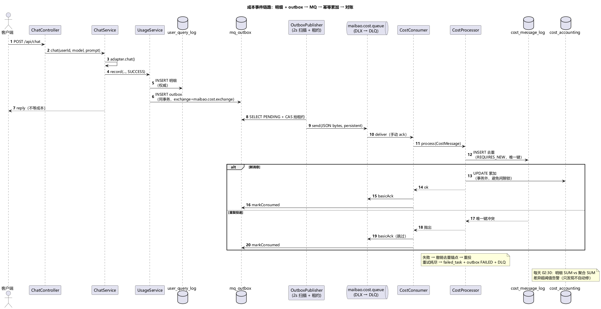
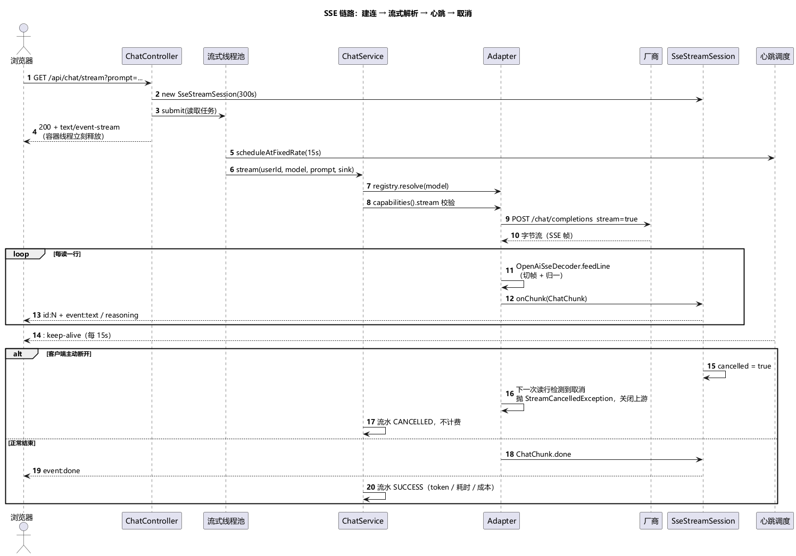

# 时序图：发布 / 成本事件 / SSE

> 三张图都由 PlantUML 渲染为 PNG，源文件在 `docs/diagrams/*.puml`。
> 括号里是运行时线程名，可在 `logs/app.log` 里对照。

---

## 1. 发布链路：抢占 → 执行 → 收尾 / 回收


涉及线程：`http-nio-*`（请求）、`scheduling-1`（调度）、`publish-exec-N`（执行池）。

### 为什么这么设计

| 决策 | 原因 |
|---|---|
| `claimed_at` 与状态写在同一条 UPDATE | 分两条写会出现「状态已变、时间没写」，回收任务会把正在执行的记录误判成卡死 |
| 执行与回收都用条件更新 | 两个线程可能同时收尾；只有影响行数为 1 的那个算数，另一个自然落空 |
| 执行池用 `CallerRunsPolicy` | 队列满时回退到调度线程执行，形成背压；丢任务会留下永远停在 `PUBLISHING` 的记录 |
| 回收阈值独立于执行超时 | 执行耗时是业务属性，卡死阈值是运维属性，两者不该耦合 |

### 竞态时间线（实测）

```
t=0.0s   claimed（scheduling-1）
t=0.0s   publish 开始（publish-exec-1，耗时 5s）
t=5.0s   recoverStuck → FAILED（scheduling-1）
t=5.01s  execute 收尾 → UPDATE 影响 0 行 → state advanced: false
```

---

## 2. 任务链路（已停用，保留图）

> `app.task.enabled=false` 关闭，`/api/task/submit` 已删除。保留这张图是因为队列、幂等表、死信体系都还在，长任务模型接入后直接复用。


涉及组件：`OutboxService`（业务落库）、`OutboxPublisher`（定时投递 + 对账）、`TaskConsumer`（消费）、`TaskProcessor`（调模型 + 记成本）、`TaskDedupeService`（幂等锚点短事务）、`failed_task` / `mq_outbox` / 用量表（兜底与回执）。

### 为什么这么设计

| 决策 | 原因 |
|---|---|
| 先写 `mq_outbox` 再投递 | 直接「commit 后 send」，send 失败就永久丢消息，且没有记录能补救 |
| 用 `next_retry_at` 做租约 CAS 抢占 | 多实例同时扫同一张表会重复投递；`UPDATE ... WHERE status='PENDING' AND next_retry_at<=now` 影响行数为 1 才发，抢不到的实例跳过 |
| confirm 决定 `SENT` 还是重试 | 只有 broker 确认收下才算投递成功；nack 就退避重投 |
| returns 单独处理 | 「没路由到任何队列」是配置错，重试没有意义，直接 `FAILED` 并告警 |
| 幂等锚点用独立短事务先提交 | 业务要调外部模型，不能把数据库事务跨越网络调用；锚点先挡住重复投递，失败再撤销 |
| 不是所有错误都重试 | `AUTH` / `FILTERED` / 业务参数错误重试无用，直接 `failed_task` + DLQ；只有限流/超时/5xx 才重投 |
| 失败用「重新投递 + 计数头」而不是 `nack(requeue=true)` | 立即重回队列会原地打转，把消费者钉死 |
| 重试耗尽写 `failed_task` 并 nack | 消息进 DLQ 保留现场，同时释放队列 |
| 终态失败同时把 outbox 标 `FAILED` | 只写 `failed_task` 不写 outbox，`SENT` 行会被对账打回重投，同一条消息反复执行（见 [04-缺陷记录](04-缺陷记录.md) BUG-001） |
| 每分钟对账 | `SENT` 超过 5 分钟没有消费回执 → 重投；重试次数用尽 → `FAILED` |

### 关键指标

| 指标 | 含义 |
|---|---|
| `mq.publish.confirm{result=ack\|nack}` | 生产端确认结果 |
| `mq.publish.returned` | 消息未路由到任何队列 |
| `mq.consume.success` | 正常消费 |
| `mq.consume.duplicate` | 唯一约束拦下的重复投递 |
| `mq.consume.retry` | 失败后重新投递 |
| `mq.consume.failed` | 重试耗尽，已写 `failed_task` |

查看方式：`GET /actuator/metrics/mq.consume.success`

---

## 3. 成本事件链路：明细 + outbox → MQ → 幂等累加



涉及组件：`UsageService` / `UsageWriter`（明细 + outbox 同事务）、`OutboxPublisher`（租约投递）、`CostConsumer`（手动 ack）、`CostProcessor`（去重 + 累加）、`CostReconcileJob`（T-1 对账）。

### 为什么这么设计

| 决策 | 原因 |
|---|---|
| 对话只写明细和 outbox，不等聚合 | 聚合是派生数据，不该拖慢对话 RT；outbox 与明细同事务，消息不会丢 |
| `request_id` 当幂等键 | 它就是"一次调用"的唯一标识，重复投递只累加一次 |
| 去重锚点用 `REQUIRES_NEW` 先提交 | 累加是"UPDATE 不中再 INSERT"，同事务会踩间隙锁（见 docs/03） |
| `stat_date` 生产端算 | 消费端跨天重投会把账记到错误日期 |
| 终态失败同时标 outbox `FAILED` | 只写 `failed_task` 会让 `SENT` 行被对账反复重投（docs/04 BUG-001） |
| 每天 02:30 对 T-1 | 当天的账还在滚动；只发现不自动修 |

---

## 4. SSE 链路：建连 → 流式解析 → 心跳 → 取消



涉及线程：`http-nio-*`（建连后立即释放）、`maibao-stream-N`（读上游）、`sse-heartbeat-1`（心跳）。

### 为什么这么设计

| 决策 | 原因 |
|---|---|
| `SseEmitter` + 独立线程池 | 每个流占一个 Tomcat 线程的话，几十个流就打满容器线程 |
| 帧解析放在适配器内部 | 传输分片不等于事件边界，攒 buffer 按空行切帧，粘包/半包都在 `SseFrameParser` 里处理 |
| 每 15s 一个 `: keep-alive` | Nginx/网关默认 60s 空闲断连，长回答会被拦腰切断 |
| 每个事件带自增 `id` | 重连/乱序时前端可以去重，排查时能对上是第几帧 |
| 取消传播到上游 | 客户端断开后继续读，用户走了还在烧 token，成本白付 |
| 超时分层 | 连接 5s / 首字节 30s / 整体 300s，分别对应建连失败、模型不吐字、僵尸流 |

### 实测数据（慢速 mock，900ms/字）

```
32 个事件带 id，30 个 text 帧，1 个 done
1 个 : keep-alive（第 15s）
客户端 3s 断开 → 流水 status=CANCELLED，只记了 7 个 token
```

---

## 5. 几条链路的关系

发布走「状态机 + 线程池」，成本走「outbox + 消息队列」，对话走「SSE + 适配器」——几条路彼此独立，共同点只有两条：

1. **中间状态必须可恢复**：发布卡在 `PUBLISHING` 有回收任务，消息投递有 outbox 重试与对账，流式有超时与取消。
2. **并发正确性靠数据库条件更新与唯一约束**，而不是靠加锁或「先查后写」。

---

## 6. 重新生成 PNG

源文件：`docs/diagrams/publish-sequence.puml`、`mq-sequence.puml`、`cost-sequence.puml`、`sse-sequence.puml`。

```bash
# 需要 PlantUML jar（不随仓库提交）
java -Djava.awt.headless=true -jar plantuml.jar -tpng -charset UTF-8 -o .. docs/diagrams/*.puml
```

中文字体由 `skinparam defaultFontName "Microsoft YaHei"` 指定；在 Linux/macOS 上渲染时换成系统里已安装的中文字体即可。
